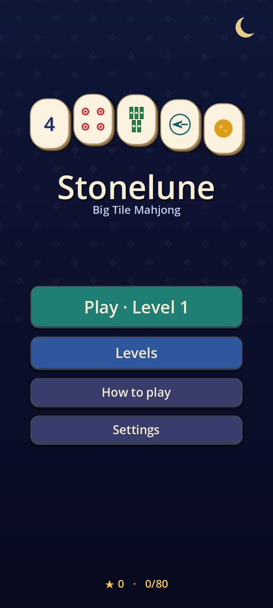
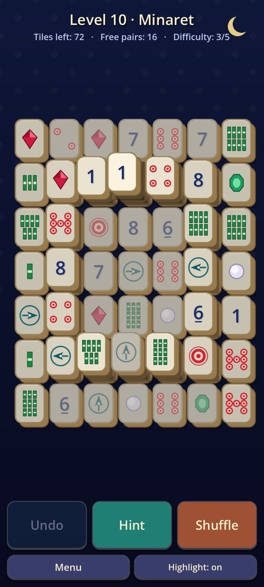
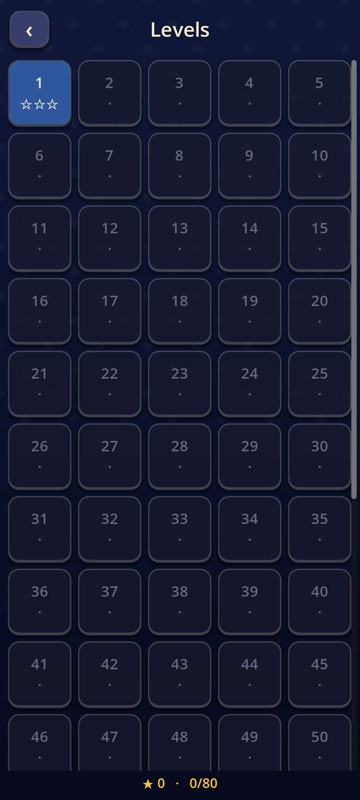
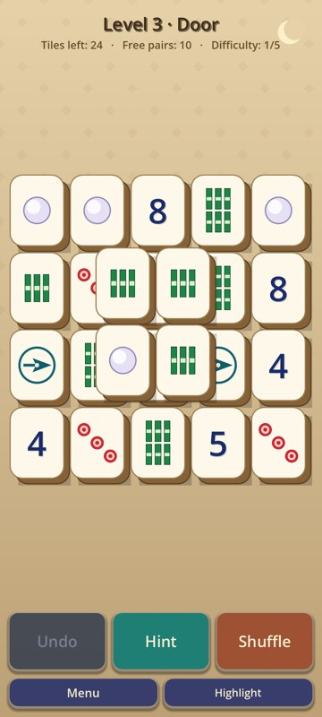

# Stonelune: Big Tile Mahjong

A calm tile-matching solitaire for Android with big, easy-to-tap tiles: find two free tiles with the same picture and clear the whole board. Offline, no accounts, and every board is built so it can be solved.

[Türkçe](#türkçe) · [Privacy policy](privacy.md)

  
  
  
  

## Download

- **Android:** coming to Google Play.

## Features

- **Big tiles:** sized for fingers, with our own hand-drawn symbols (no Chinese characters to learn).
- **Every board can be solved:** boards are generated backwards from a finished position, and a solver checks them.
- **Never lost:** undo, a hint that lights up a good pair, a shuffle, and a warning as soon as a move leaves the board unsolvable.
- **Easy to read:** free tiles stay bright, closed tiles dim; tap a closed tile and the tiles blocking it glow, with no penalty.
- **Gentle start, steady climb:** short boards first, then bigger, layered ones.
- Four colour themes, English and Turkish, phone and tablet.

## Support

luneapps.support@gmail.com

---

## Türkçe

Büyük ve kolay dokunulan taşlarla sakin bir taş eşleştirme pasyansı: aynı resimli iki serbest taşı bul, bütün tahtayı temizle. Çevrimdışı, hesapsız; her tahta çözülebilecek şekilde üretilir.

- **Büyük taşlar:** parmağa göre ölçülü, kendi çizdiğimiz semboller (Çince karakter yok).
- **Her tahta çözülebilir:** tahtalar bitmiş durumdan geriye doğru üretilir ve çözücüyle denetlenir.
- **Asla çaresiz kalmazsın:** geri al, iyi bir çifti gösteren ipucu, karıştırma ve bir hamle tahtayı çözümsüz bırakınca anında uyarı.
- **Okunaklı:** serbest taşlar parlak, kapalı taşlar soluk; kapalı taşa dokunursan onu kapatan taşlar yanar, ceza yok.
- **Yumuşak başlangıç:** önce kısa tahtalar, sonra büyük ve katmanlı olanlar.
- Dört renk teması, Türkçe ve İngilizce, telefon ve tablet.

**Destek:** luneapps.support@gmail.com
